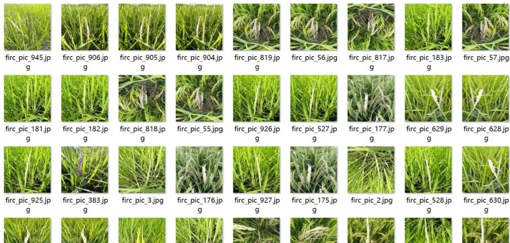
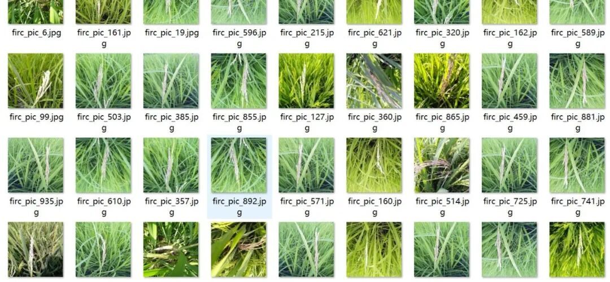
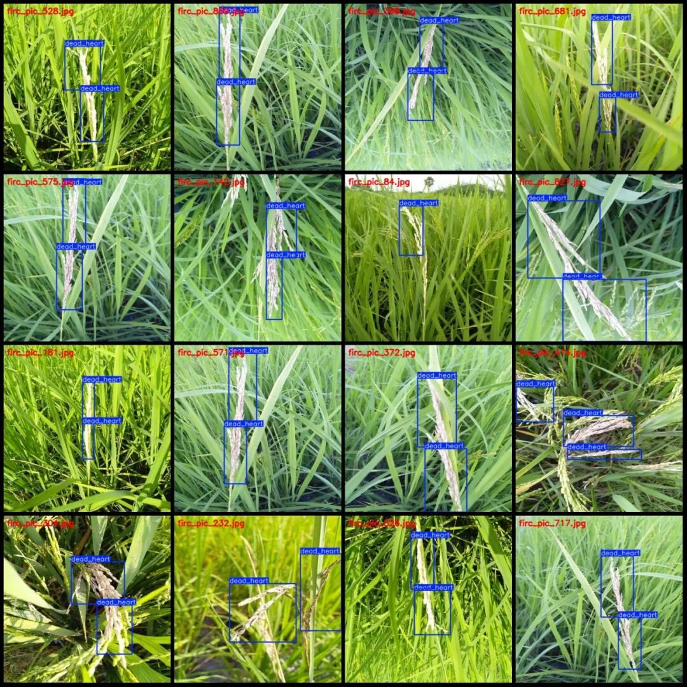
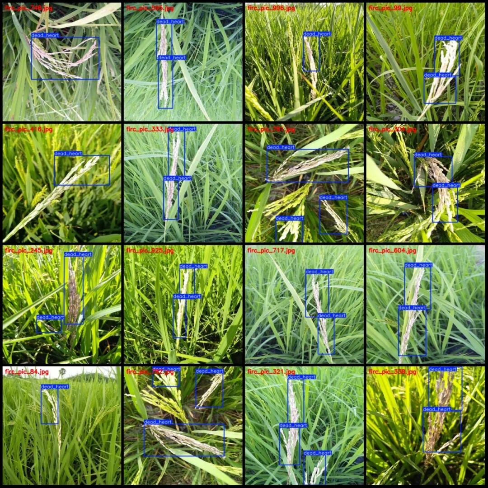

# Intelligent Agriculture Rice Blast, Scab and Wilt Disease Detection Dataset in VOC+YOLO format with 948 images across 10 categories

Please note that in the dataset, aside from the frame with the wilt disease, there are fewer frames. For a more detailed look at the statistics, approximately 310 images are originals that have been enhanced by a factor of 1:2. Please carefully examine the images.

Dataset format: Pascal VOC format + YOLO format (txt file without split path, only containing jpg images and corresponding VOC format xml files and yolo format txt files)

Number of images (number of jpg files): 948

Number of annotations (number of xml files): 948

Number of annotations (number of txt files): 948

Label category count: 10

Label category names (Note that the order of categories in the YOLO format does not correspond to this, but is based on the classes.txt file in the labels folder): ["bacterial_leaf_blight", "bacterial_leaf_streak", "bacterial_panicle_blight", "blast", "brown_spot", "dead_heart", "downy_mildew", "hispa", "normal", "tungro"]

Number of boxes labeled in each category:

bacterial_leaf_blight (bacterial leaf blight) frame count = 3

bacterial_leaf_streak (bacterial leaf streak) frame count = 9

bacterial_panicle_blight (bacterial sheath blight) frame count = 6

Blast (Pest) Frames = 3

brown_spot (Brown Spot) frame count = 6

dead_heart (with 2007 frame count)

downy_mildew (powdery mildew) Frames = 3

hispa (rice tiger moth) frame count = 9

Normal (normal) box count = 3

Tungro (Eastern Guinea Equine Encephalitis) frame count = 3

Total frame count: 2052

Number of images per category:

Bacterial Leaf Blight (bacterial_leaf_blight) occupies = 3

Bacterial Leaf Streak (Bacterial Leaf Spot) - Pictures = 3

Bacterial Panicle Blight (bacterial sheath blight) occupies 3 images.

Blast (Pest) occupies 3 images.

brown_spot (Brown Spot) occupies = 3

dead_heart (withdrawal) occupies a picture count = 921

downy_mildew (powdery mildew) occupies = 3

hispa (rice tiger) occupies = 3

Normal (normal) occupancy count = 3

Tungro (Eastern Gulu Virus Disease) occupies a picture count = 3

Image resolution: 500x500

Using labelImg:

Annotation rules: Draw a rectangle around the category.

Important Notice: The dataset does not have separate training, validation, and test sets; you need to partition them yourself.

Special : This dataset does not guarantee the accuracy of the trained models or weight files.

Image Preview:

Annotation example:

## Payment

Here is a pay link on Stripe ( https://buy.stripe.com/3cs8yP7sY87d0vu9AB ). Please contact me lonlonago@foxmail.com after funding $89, and I will send you a complete data files , thank you!

